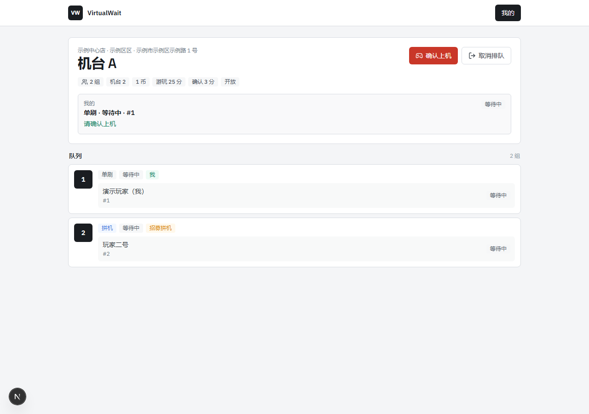
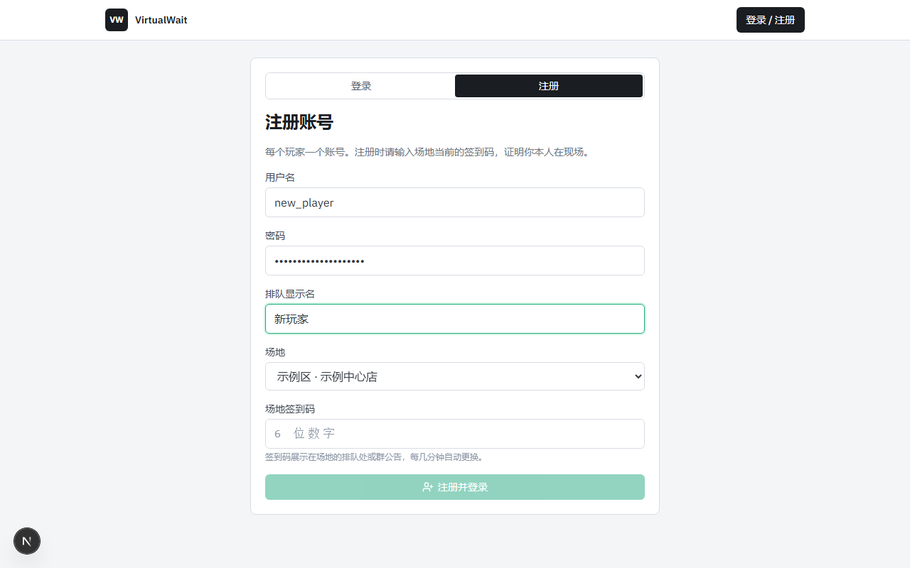
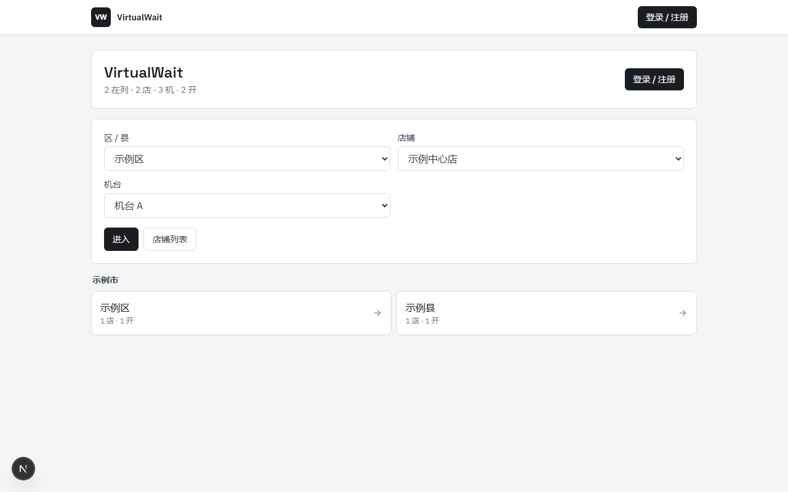
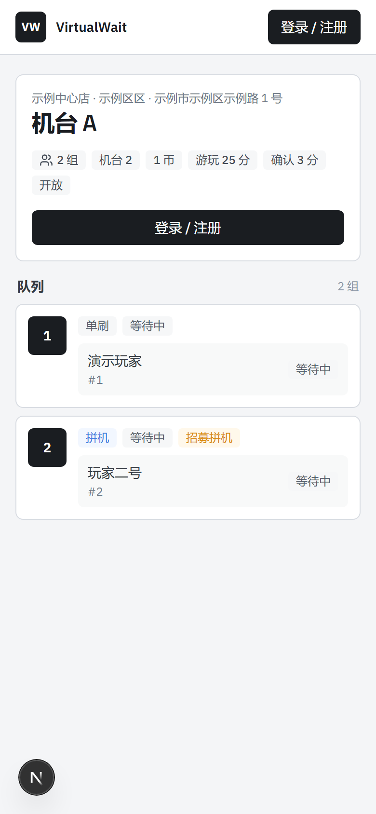

<div align="center">

# VirtualWait

**机厅虚拟排卡（线上排队）系统 · 每人一个本地账号 · 场地签到码入场**

不用实体排队卡，也不用扫机台二维码：玩家用**自己的账号**登录排队，
注册时输入**现场签到码**证明本人在场。系统只读写自己的 SQLite，
**不连接任何游戏服务器、身份服务或第三方平台**。

[](https://github.com/Bad0RANG3/VirtualWait-Template/actions/workflows/verify.yml)
[](LICENSE)
[](apps/web/package.json)
[](services/bot/requirements.txt)
[](#%E6%9E%B6%E6%9E%84)



<sub>机台队列板：单刷 / 拼机同队展示，队首「确认上机」，超时自动排到队尾</sub>

</div>

---

## 目录

- [它解决什么](#它解决什么)
- [核心能力](#核心能力)
- [效果图](#效果图)
- [架构](#架构)
- [快速开始](#快速开始)
- [账号与场地签到码](#账号与场地签到码)
- [排队规则](#排队规则)
- [QQ 机器人叫号](#qq-机器人叫号)
- [生产部署](#生产部署)
- [环境变量速查](#环境变量速查)
- [质量门禁](#质量门禁)
- [仓库结构](#仓库结构)
- [文档](#文档)
- [约束与红线](#约束与红线)
- [许可](#许可)

## 它解决什么

| 痛点 | VirtualWait 的做法 |
|---|---|
| 实体排队卡容易丢、容易被插队、无法远程查看 | 手机打开网页就能看队列、入队、取消 |
| 双人拼机靠喊人，来回问「有人一起吗」 | 队列板直接显示「招募拼机」，点一下就加入 |
| 叫号靠店员喊，忙起来顾不上 | 机台空闲时 QQ 机器人 @ 队首；网页端也会提示「请确认上机」 |
| 队首不在/没听见，队列卡住 | 3 分钟未确认 → **整组自动排到队尾**，不会卸卡也不会卡死 |
| 借用别人身份排队、一人多开 | 一人一账号（用户名 + scrypt 口令），同一人同时只能有一条活跃记录；每 IP 每日注册配额 |
| 需要把玩家身份交给第三方验证 | **完全不需要**：注册用现场签到码证明在场，口令哈希只存在本地 SQLite |

## 核心能力

| 能力 | 说明 |
|---|---|
| 🎫 **本地账号身份** | 用户名（3–20 位 `A-Za-z0-9_-`）+ 口令（8–128 位，scrypt 加盐哈希）+ 展示昵称（唯一，NFKC 归一） |
| 📍 **场地签到码** | 6 位动态码，由场地密钥与时间窗口 HMAC 派生，默认 600 秒轮换；注册必填，注册即绑定场地 |
| 🧾 **虚拟排卡** | 城市 → 区县 → 场地 → 机台四级目录、公开队列板、单人 / 双人拼机 |
| ⏱️ **自动回队尾** | 结束游玩、游玩超时（默认 1500s）、队头确认超时（默认 180s）都会自动回队尾，可随时取消离开 |
| 🛠️ **运维台** | 队列开闭、代开始 / 重排 / 取消 / 结束、超时与硬币、场地信息、签到码查看与轮换、审计事件 |
| 🤖 **QQ 叫号机器人** | NoneBot2 + NapCat：机台空闲时在对应群 @ 队首（可选，Docker 一键部署） |
| 🛡️ **防滥用** | 注册 / 登录限流、每 IP 每日注册配额、会话服务端可吊销、口令不落明文、账号枚举防护 |
| 🧰 **运维全家桶** | SQLite(WAL)、Nginx / systemd 模板、备份与校验、健康检查、常驻维护、一键门禁 |

## 效果图

<div align="center">



<sub>注册：用户名 + 口令 + 昵称 + 现场签到码（一次注册，之后直接用账号登录）</sub>


<sub>运维台：每个场地当前有效的签到码、轮换倒计时与「立即轮换」</sub>

| 首页目录 | 移动端队列板 |
|:---:|:---:|
|  |  |

</div>

## 架构

```text
玩家手机 ──HTTPS──► 反向代理（可选 Nginx）──► Web (Next.js + SQLite, 127.0.0.1:3000)
                                                  │
                                                  ├─ 账号 / 会话 / 签到码
                                                  ├─ 队列状态机 + 运维台 API
                                                  ├─ Bot API（Bearer，可选）
                                                  └─ 本地 SQLite（WAL）── 维护进程（超时推进 + 保留期清理）

QQ ──OneBot v11 WS──► NapCat ──► Bot (NoneBot2, services/bot)
                       └──Bearer──► Web /api/bot/* ──机台空闲──► 群里 @ 队首
```

**单机单实例、零外部依赖**：身份、队列、运维台和机器人接口都在同一个 Next.js 进程里，
数据在本地 SQLite；没有 Gateway、没有上游 provider、没有游戏协议客户端。

## 快速开始

前置要求：**Node.js 22.5+**（Web 使用 `node:sqlite`）；可选 Python 3.10+（跑机器人）。

```bash
git clone https://github.com/Bad0RANG3/VirtualWait-Template.git
cd VirtualWait-Template/apps/web
npm ci
cp .env.example .env.local     # 至少填 SESSION_SECRET 与 ADMIN_API_TOKEN
npm run dev                    # http://localhost:3000
```

打开 http://localhost:3000 ，按下面三步体验完整流程：

1. **拿签到码**：进入 `/admin`，用 `.env.local` 里的 `ADMIN_API_TOKEN` 登录，
   在「场地签到码」面板读取当前 6 位码（每 10 分钟自动更换，可手动轮换）；
2. **注册账号**：回到 `/login` → 切到「注册」页签 → 用户名 + 口令 + 昵称 + 上面的签到码；
3. **去排队**：在 `/me` 绑定 QQ（`REQUIRE_QQ_FOR_QUEUE=false` 时可不绑）→ 选机台 → 入队 → 队首点「确认上机」。

> 想连手机一起试？`next dev` 默认监听所有网卡，用启动日志里的 Network 地址（例如 `http://192.168.x.x:3000`）即可。
> 想清空演示数据：`npm run db:reset`。

### 现场开户（关闭自助注册时）

```bash
cd apps/web
printf '%s' '玩家口令' | npm run account:create -- --username player01 --nickname '玩家一号' --qq 12345678
```

校验规则与自助注册完全一致（用户名 / 昵称 / 口令强度、唯一性），不需要签到码，也不消耗每 IP 配额；
口令走 stdin，不会留在 shell 历史里。

## 账号与场地签到码

- **账号** = 用户名 + 口令 + 昵称。口令用 Node 内置 scrypt（N=16384, r=8, p=1）加盐哈希，
  只在本地 SQLite 保存哈希与盐；用户名不存在时也执行等价计算，失败统一返回
  `INVALID_CREDENTIALS`，避免被拿来枚举账号。
- **签到码** = `HMAC-SHA256(场地密钥, "vw-checkin:<时间窗口>")` 取 6 位数字。
  密钥每场地独立、随机、懒生成，只存在 SQLite；默认 600 秒轮换并额外接受 1 个历史窗口，
  轮换后旧码立即失效（码外泄时的处置手段）。
- **每 IP 每日注册配额**（默认 5）只作用于**注册**；登录只记录来源，不受配额限制——
  场馆共享 Wi-Fi / NAT 会服务很多玩家，把登录也纳入配额会把常客挡在门外。
- **登录限流**：按账号统计**所有**尝试（防定向爆破），按客户端 IP 只统计**失败**尝试（防撞库但不误伤同网玩家）。
- **会话**：HMAC 签名的 `vw_session` Cookie（HttpOnly / SameSite=Strict / 生产 Secure）+ `session` 表行，
  登出即服务端吊销，命中时校验客户端 IP 连续性。

## 排队规则

| 事件 | 行为 |
|---|---|
| 入队 | 单人直接排队；双人发起「招募拼机」，另一人加入后双方确认成组 |
| 队首确认 | 机台空闲时队首获得确认窗口（`HEAD_CONFIRM_TIMEOUT_SEC`，默认 180s） |
| 确认超时 | **整组自动排到队尾**（单刷 / 拼机都算一组），下一组获得新的确认窗口；该组记账一次「错过」，机器人会重新 @ |
| 游玩中 | 机台忙碌；游玩超时（`PLAYING_TIMEOUT_SEC`，默认 1500s）后自动回队尾 |
| 结束游玩 | 用户或管理员结束时**自动回队尾**继续排队，不想继续就取消 |
| 随时取消 | 玩家可随时取消离开；管理员可代开始 / 重排 / 取消 / 结束 |
| 一人一条 | 同一用户在任意队列中只允许一条等待 / 游玩记录（数据库唯一索引兜底） |

## QQ 机器人叫号

机器人只做一件事：轮询受保护的 Bot API，机台空闲时在对应群 @ 队首。它**不连接游戏服务器**，
不处理任何账号数据。群路由优先级：场地 `groupUmo` → `QUEUE_NOTIFY_ROUTING[venueSlug]` →
`QUEUE_NOTIFY_DISTRICT_ROUTING` → `QUEUE_NOTIFY_DEFAULT_GROUP`。

```bash
docker compose -f infra/docker/docker-compose.bot.yml up -d --build
docker compose -f infra/docker/docker-compose.bot.yml logs napcat | grep -E "WebUi (Token|User Panel Url)"
```

按日志地址打开 WebUI 扫码登录机器人 QQ（唯一手动步骤）。Web 侧需设置 `BOT_API_TOKEN`，
机器人侧填一致的 `QUEUE_NOTIFY_BOT_TOKEN`。开通前请阅读
[队列通知联动](docs/QUEUE_NOTIFY.md) 与 [机器人部署](services/bot/DEPLOY.md)。

## 生产部署

详细步骤见 [部署文档](docs/DEPLOYMENT.md) 与 [infra/server/README](infra/server/README.md)。

| 方式 | 适用 | 要点 |
|---|---|---|
| **A. Linux 全栈（systemd + Nginx）** | 推荐生产 | `npm ci && npm run build`，装 `infra/server/systemd/` 的 web / maintenance / backup / healthcheck 单元与 Nginx 模板 |
| **B. 机器人 Docker 镜像** | 推荐机器人 | `ghcr.io/bad0rang3/virtualwait-bot` 预构建镜像，NapCat + NoneBot2 一起拉起 |
| **C. 本地 / 内网** | 体验与联调 | 见上方快速开始，无 TLS |

生产必做三件事：

1. `SESSION_SECRET` / `ADMIN_API_TOKEN` 各自独立随机（≥32 字符），只从 secret manager 或 `chmod 0600` 的环境文件注入；
2. 应用**只监听回环**（`npm run start` 默认 `HOST=127.0.0.1`）并在防火墙上封禁该端口——
   生产强制 `TRUST_PROXY_HEADERS=true`，谁能直连端口谁就能伪造客户端 IP；
3. 定期 `npm run db:backup` + `npm run db:verify`，保持 `virtualwait-maintenance` 常驻。

## 环境变量速查

| 分组 | 变量 | 默认 |
|---|---|---|
| 密钥 | `SESSION_SECRET`、`ADMIN_API_TOKEN` | 无（生产必填，≥32 字符） |
| 站点 | `APP_BASE_URL`、`HOST`、`PORT`、`VIRTUALWAIT_DATA_DIR` | `127.0.0.1` / `3000` / `./data` |
| 注册 | `REGISTRATION_ENABLED`、`CHECKIN_REQUIRED`、`CHECKIN_WINDOW_SEC`、`CHECKIN_GRACE_WINDOWS` | `true` / `true` / `600` / `1` |
| 防滥用 | `IP_ACCOUNT_QUOTA_PER_DAY`、`REGISTER_*`、`LOGIN_*` | `5` / 见 `.env.example` |
| 队列 | `PLAYING_TIMEOUT_SEC`、`HEAD_CONFIRM_TIMEOUT_SEC`、`REQUIRE_QQ_FOR_QUEUE` | `1500` / `180` / `true` |
| 机器人 | `BOT_API_TOKEN`、`BOT_CATALOG_RATE_LIMIT`、`BOT_QUEUE_RATE_LIMIT` | 空（关闭） / `20` / `240` |
| 运维 | `MAINTENANCE_INTERVAL_SEC`、`DB_BUSY_TIMEOUT_MS`、`*_RETENTION_*` | `15` / `5000` / 见 `.env.example` |

完整清单与说明见 [`apps/web/.env.example`](apps/web/.env.example) 与
[生产样例](infra/server/env/web.production.env.example)。

## 质量门禁

```bash
node scripts/verify-all.mjs      # 一键跑完全部门禁
```

| 门禁 | 内容 |
|---|---|
| 部署样例 / Nginx 模板 | 环境文件与反向代理模板的静态检查 |
| `npm run preflight -- --production` | Node 版本、生产密钥形状、代理头、仓库泄露扫描、退役配置不得回流 |
| `npm test` | 45 个单测：口令、账号、签到码、限流与配额、旧库迁移、备份无副作用、取消/超时竞争、队列超时、数据保留、Bot 领域 |
| `npm run test:e2e` | 无浏览器 HTTP E2E：同源防护、注册、口令登录与失败、绑定 QQ、入队、管理操作与审计、登出吊销 |
| `npm run test:browser` | Playwright：桌面注册登录、运维台签到码、移动端无横向溢出 |
| `npm run build` | 生产构建与路由可用性 |
| `pytest services/bot/tests` | 机器人通知判定（含超时后重新叫号） |

浏览器门禁需要先 `npx playwright install chromium`，或用 `PLAYWRIGHT_CHROMIUM_EXECUTABLE` 指定系统 Chromium。

## 仓库结构

```text
apps/web/              Next.js 应用：账号与队列 API、虚拟排卡前端、运维台、SQLite、Bot API
services/bot/          NoneBot2 QQ 机器人（仅队列叫号）
infra/server/          Nginx / systemd / 环境变量样例
infra/docker/          机器人镜像与 compose
docs/                  架构、技术规格、安全、约束、部署、模块手册、机器人联动
scripts/verify-all.mjs 一键门禁入口
```

## 文档

| 文档 | 内容 |
|---|---|
| [架构与队列流程](docs/ARCHITECTURE.md) | 拓扑、账号与签到码流程、模块地图、队列规则与 API 概览、升级注意 |
| [技术规格与上线验收](docs/TECHNICAL_SPEC.md) | 系统边界、状态机、数据与保留策略、安全规格、质量门禁与验收清单 |
| [安全与发布清单](docs/SECURITY.md) | 不可提交的数据、口令与签到码、密钥管理、网络与发布检查 |
| [约束与红线](docs/CONSTRAINTS.md) | 不得破坏的配对密钥、账号纪律、架构与机器人约束 |
| [模块手册](docs/MODULES.md) | 按目录列出各模块职责、API 路由、组件、脚本与测试索引 |
| [部署文档](docs/DEPLOYMENT.md) | 部署方式、systemd / Nginx 步骤、升级与备份、故障处置 |
| [模板定制](docs/TEMPLATE.md) | 替换目录、品牌文案、身份与队列策略 |
| [队列通知联动](docs/QUEUE_NOTIFY.md) | Bot API 字段映射、通知判定、群路由与联调测试矩阵 |

## 约束与红线

- **不要再引入**任何外部身份服务、游戏服务器或第三方协议客户端（历史版本曾包含独立身份 Gateway 与共享客户端包，均已移除）；
- 生产强制 `TRUST_PROXY_HEADERS=true`：必须由代理覆盖转发头，且应用只监听回环；
- SQLite **单机单实例**，未迁移服务型数据库前不要横向扩容；
- 公开队列接口**永不返回 QQ、用户名、IP**；Bot API 含队首 QQ，视为管理面；
- `virtualwait-maintenance` 必须常驻；`BOT_API_TOKEN`（Web）与 `QUEUE_NOTIFY_BOT_TOKEN`（Bot）必须一致；
- 口令只以 scrypt 加盐哈希保存，签到码只通过运维台轮换，发现外泄立即轮换。

完整清单见 [安全与发布](docs/SECURITY.md) 与 [约束与红线](docs/CONSTRAINTS.md)。

## 许可

[MIT](LICENSE) © 2026 Bad0RANG3

> 运营方负责确认排队系统与 QQ 群通知中的个人信息处理符合适用法律、平台规则与场地政策。
> 公开接口不得包含 QQ；场地签到码会展示在现场，属于「证明在场」的弱凭据，不应作为账号口令使用。
